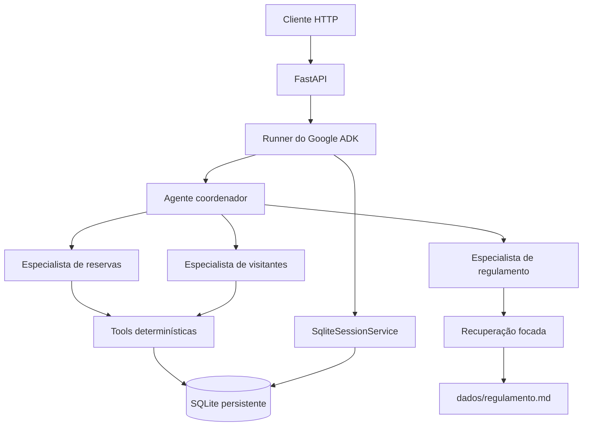

# Assistente Virtual do Residencial Aurora

API assíncrona em Python e Google ADK para atender moradores do condomínio com
reservas, visitantes e dúvidas sobre o regulamento. O modelo decide o percurso
da conversa; autorização, cobrança, identidade e concorrência são decididas por
código e persistência.

## Recursos

- agente coordenador e três especialistas;
- reservas de áreas comuns e cancelamento das reservas próprias;
- autorização de visitantes;
- confirmação persistente para ações de cobrança ou acesso;
- sessão vinculada a um único apartamento;
- eventos e dados preservados em reinícios;
- recuperação focada do regulamento;
- exclusividade atômica de área por data;
- API JSON compatível com o fluxo do desafio.

## Arquitetura



### Responsabilidades dos agentes

| Agente | Responsabilidade | Como é acionado |
|---|---|---|
| `aurora_coordinator` | Entende a intenção e delega o trabalho | Agente raiz do Runner |
| `especialista_reservas` | Disponibilidade, listagem, cancelamento e reserva | Transferência do coordenador para pedidos de áreas |
| `especialista_visitantes` | Listagem e solicitação de entrada de visitantes | Transferência do coordenador |
| `especialista_regulamento` | Responde apenas com artigos recuperados | Transferência para dúvidas normativas |

A configuração está em
[`src/aurora/agents/factory.py`](./src/aurora/agents/factory.py).

## Garantias

### 1. Cobrança e acesso somente com confirmação

As tools de reserva paga e visitante são `FunctionTool` configuradas com
confirmação. O ADK suspende a execução antes de chamar a função de negócio. A
API retoma a invocação correta com `FunctionResponse`, usando o identificador e
o agente persistidos nos eventos da sessão.

Código:

- [`src/aurora/tools/reservations.py`](./src/aurora/tools/reservations.py)
- [`src/aurora/tools/visitors.py`](./src/aurora/tools/visitors.py)
- [`src/aurora/runtime/conversation.py`](./src/aurora/runtime/conversation.py)

```python
FunctionTool(
    reserve_common_area,
    require_confirmation=requires_reservation_confirmation,
)
FunctionTool(authorize_visitor, require_confirmation=True)
```

A confirmação não é inferida do texto. Um id desconhecido, respondido ou
pertencente a outra sessão retorna `409`.

### 2. Cada sessão pertence a um único apartamento

A criação grava `session_id -> apartamento` em `aurora_sessions`. Toda tool
resolve esse vínculo com `SessionIdentity`; nenhuma tool recebe apartamento do
modelo. Consultas de disponibilidade retornam apenas `livre/ocupado`.

Código:

- [`src/aurora/domain/identity.py`](./src/aurora/domain/identity.py)
- [`src/aurora/tools/reservations.py`](./src/aurora/tools/reservations.py)
- [`src/aurora/tools/visitors.py`](./src/aurora/tools/visitors.py)

```python
identity = await resolve_identity(database, tool_context.session.id)
return await service.list_own(identity)
```

### 3. Nada se perde no reinício

SQLite persiste reservas, cancelamentos, códigos emitidos, visitantes e
confirmações. O `SqliteSessionService` do ADK persiste estado e eventos no mesmo
banco. O startup cria o schema se necessário, mas só restaura dados iniciais
quando o banco ainda está vazio.

Código:

- [`src/aurora/persistence/models.py`](./src/aurora/persistence/models.py)
- [`src/aurora/persistence/initialization.py`](./src/aurora/persistence/initialization.py)
- [`src/aurora/runtime/conversation.py`](./src/aurora/runtime/conversation.py)

```python
await database.create_schema()
self.session_service = SqliteSessionService(self.database.url)
```

### 4. O regulamento é consultado, não carregado

O documento oficial é dividido por artigo. A tool de busca recupera poucos
blocos pertinentes e os entrega apenas ao especialista de regulamento. O texto
integral não entra no prompt do coordenador nem no estado da sessão.

Código:

- [`src/aurora/regulation/retriever.py`](./src/aurora/regulation/retriever.py)
- [`src/aurora/tools/regulation.py`](./src/aurora/tools/regulation.py)
- [`src/aurora/agents/factory.py`](./src/aurora/agents/factory.py)

```python
passages = retriever.search(question)
return {"passagens": [...]}
```

### 5. Exclusividade atômica da reserva

O SQLite possui um índice único parcial sobre `area + data` para reservas
ativas. Assim, duas confirmações simultâneas não dependem de uma consulta
anterior: uma grava e a outra recebe um conflito de domínio normal.

Código:

- [`src/aurora/persistence/models.py`](./src/aurora/persistence/models.py)
- [`src/aurora/domain/reservations.py`](./src/aurora/domain/reservations.py)

```python
Index(
    "uq_active_reservation_area_date",
    "area",
    "date",
    unique=True,
    sqlite_where=text("status = 'active'"),
)
```

## Pré-requisitos

- Python 3.12 ou superior;
- [`uv`](https://docs.astral.sh/uv/);
- chave do Google AI Studio.

## Como rodar

```bash
cp .env.example .env
# Edite .env e defina GOOGLE_API_KEY
uv sync --locked
uv run python -m aurora.scripts.restore
uv run uvicorn aurora.api.main:app --host 0.0.0.0 --port 8000
```

A API fica disponível em `http://localhost:8000`.

Não é necessário subir banco ou outro serviço externo.

### Variáveis de ambiente

| Variável | Obrigatória | Finalidade |
|---|---|---|
| `GOOGLE_API_KEY` | sim | chave do Google AI Studio |
| `GEMINI_MODEL` | não | modelo Gemini; padrão validado no projeto |
| `DATABASE_URL` | não | caminho do SQLite persistente |
| `SEED_DIRECTORY` | não | diretório dos dados iniciais |
| `HOST` | não | host documentado/configurável |
| `PORT` | não | porta documentada/configurável |

O `.env.example` contém apenas os nomes, nunca valores. `.env` está ignorado.

## Restaurar os dados

```bash
uv run python -m aurora.scripts.restore
```

O comando restaura reservas e visitantes a partir de `dados/`, preserva sessões
e o histórico dos eventos e não altera os arquivos-fonte.

## API

### Sessões

```http
POST /sessoes
Content-Type: application/json

{"apartamento":"101"}
```

```json
{"session_id":"..."}
```

### Mensagens

```http
POST /sessoes/{session_id}/mensagens
Content-Type: application/json

{"texto":"Reserve a quadra para 2030-04-06."}
```

```json
{
  "resposta": "...",
  "confirmacoes_pendentes": []
}
```

### Confirmações

```http
POST /sessoes/{session_id}/confirmacoes
Content-Type: application/json

{"id":"...","confirmado":true}
```

O formato da resposta é o mesmo da mensagem. Id inválido, alheio ou já
respondido retorna `409`.

### Eventos

```http
GET /sessoes/{session_id}/eventos
```

Retorna todos os eventos persistidos, em ordem.

### Verificação

```http
GET /apartamentos/{apartamento}/reservas
GET /apartamentos/{apartamento}/visitantes
```

Essas rotas leem diretamente o armazenamento e não passam pelo modelo.

## Qualidade e verificação

```bash
uv run pytest
uv run ruff check .
uv run python scripts/verify_delivery.py
```

Fluxo completo contra uma API já iniciada:

```bash
uv run python scripts/acceptance_flow.py pre
# Reinicie a API sem restaurar os dados
uv run python scripts/acceptance_flow.py post
```

O roteiro cobre confirmação real, privacidade, reinício, eventos, idempotência
sequencial e aprovações simultâneas.

## Estrutura

```text
src/aurora/
├── agents/         agentes ADK
├── api/            rotas e schemas FastAPI
├── domain/         regras de negócio
├── persistence/    schema, inicialização e restauração
├── regulation/     recuperação do regulamento
├── runtime/        Runner e confirmação persistida
└── tools/          tools expostas aos especialistas
tests/              testes unitários e de integração
scripts/            restauração e verificações
docs/               especificações, planos, tarefas e status
```

## Documentação adicional

- [Especificações e plano de implementação](./docs/README.md)
- [Status e evidências](./docs/STATUS.md)
- [Mapa de capacidades](./docs/capability-map.md)
- [Enunciado original do desafio](./DESAFIO.md)

## Licença

Consulte as condições do repositório de origem e do desafio.
